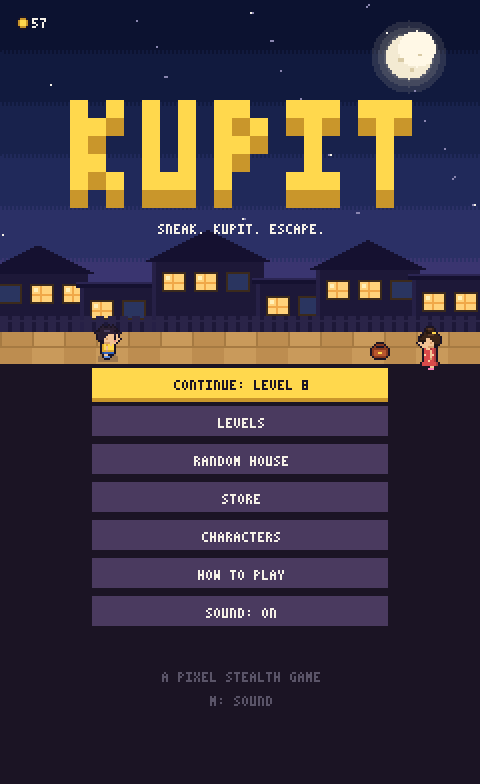
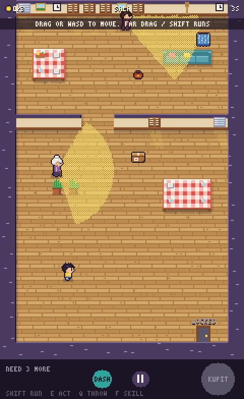
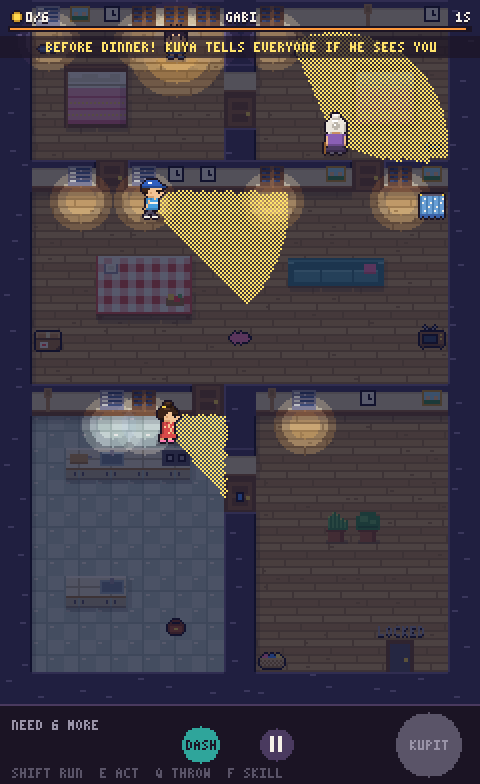
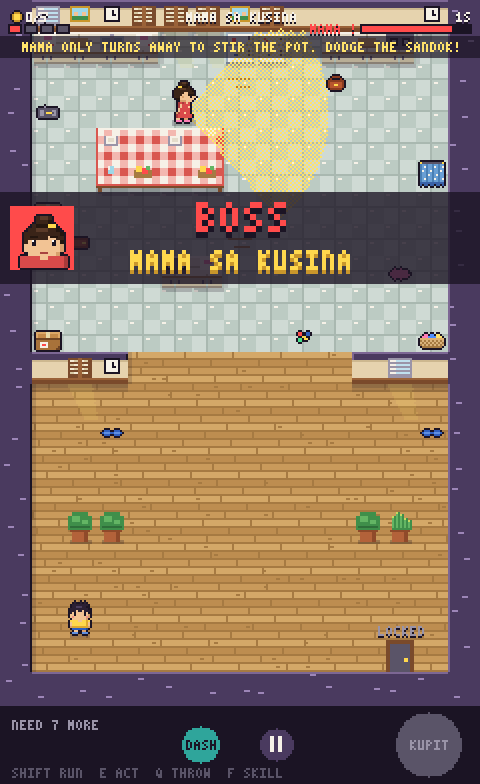
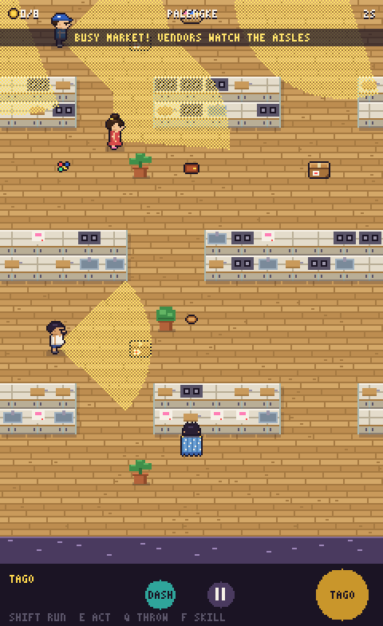
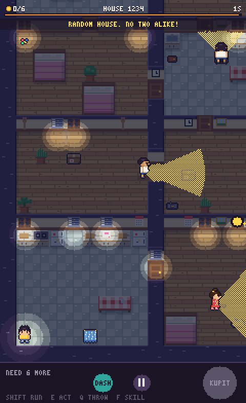
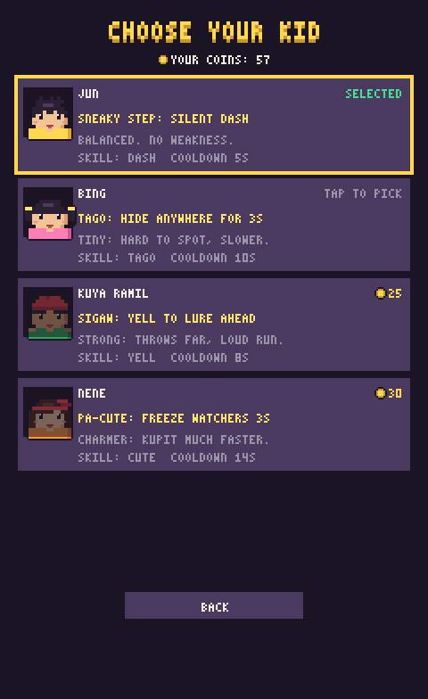
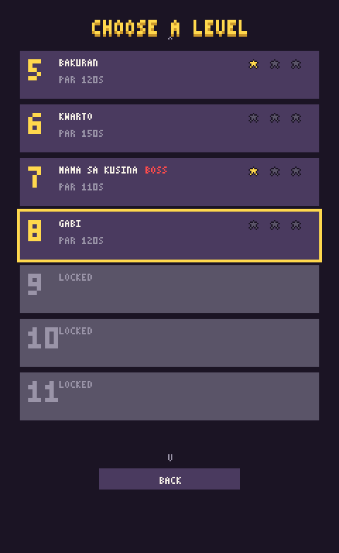
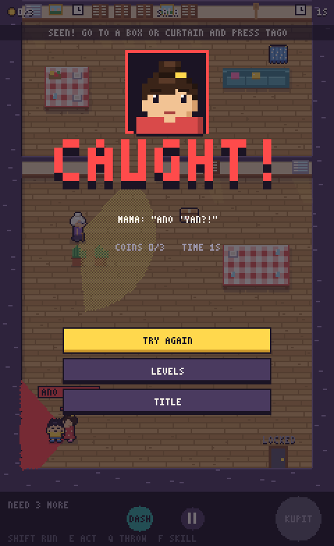

# Kupit

A pixel-art stealth game with a story. Jun has found a stray cat and her newborn kittens under the house. Mama
said no more animals, so he keeps them secret and sneaks coins out of Mama's purse, Lola's bayong and Tita's
wallet to buy them milk. His family works it out long before he does: all he ever had to do was ask.
(*Kupit* = Filipino slang for sneaking/pocketing something that isn't yours. *Hingi* = to ask for it.)

| | | |
|---|---|---|
|  |  |  |
| Title | Sala: Mama and Lola's vision cones | Gabi: night lighting |
|  |  |  |
| Boss: Mama sa Kusina | Palengke (scrolling map) | Random House |
|  |  |  |
| Characters | Level select | Caught! |

## Play

ES modules need a web server (not `file://`):

```
npm start            # or: python -m http.server 8080
```

Open http://localhost:8080 (phone on same LAN works too). If 8080 is taken, `serve` picks another port and prints
it. `?level=2` jumps to a level, `?daily` to today's Daily House.

| Action | Keyboard | Touch |
|---|---|---|
| Move (sneak) | WASD / arrows | drag anywhere |
| Run (loud!) | Shift | drag far |
| Act: kupit (hold), hide, open/close door, switch, turn on TV/radio | E / Space | big button (its icon shows what it will do) |
| Throw tsinelas / pandesal: hold to aim, let go to throw | Q | blue button |
| Switch which item you throw | R / Tab | small dot next to it |
| Character skill | F / X | green button |
| Pause | P / Esc | pause button |
| Sound on/off | M | Options |

Collect the coin quota, then reach the exit.

- **Adults** have vision cones. Fill their meter and they **chase** you (A* pathing). Break line of sight or hide, and
  they search, then go back. `?` over an adult means suspicious, `!` means chase. On big maps, arrows on the screen
  edge show who is onto you, and pings show noises heard off screen.
- **Caught?** You get 3 chances per level. Each catch is a short scolding, a third of your coins go back to where
  they came from, and you start again at the last safe spot (a hiding spot or doorway you passed calmly). The third
  catch ends the level. A catch costs any "never caught" or "no alarm" star, and par time keeps running.
- **Noise** travels through the rooms: walls stop it and closed doors muffle it. Running, creaky floors, lego (ARAY!)
  and every stash make noise. Purses click, bayongs rustle, wallets zip, and riskier stashes hold more coins. Letting
  go of a half-done kupit keeps most of the progress.
- **Hide** in boxes, curtains and laundry baskets. An eye over you means someone watched you hide, so they'll find you.
- **Secret alkansya**: every level hides one bonus stash off the main route.
- **Bosses** each have a signature rule and finale. Lola's Siesta: a sleep meter that noise drains, then a finale
  where any sound sets her off. Mama sa Kusina: sandok throws. Tatay + Aso: Tatay follows the dog's barks, so
  pandesal splits them. Ninang's Fiesta: guests are moving cover. Bagyo: the storm, and rising water.
- **Late levels** add the tanod (sweeping flashlight, whistle), tinderas (shout MAGNANAKAW!, stay by their stall)
  and a tricycle on a timed route.
- **Random House**: a seeded generator builds a new multi-room house at difficulty 1–5. Mutators (BROWNOUT, WALANG
  TSINELAS, BISITA) make it harder and pay more, and clearing them at level 3+ unlocks outfits. Payouts shrink with
  each house cleared the same day. The **Daily House** is the same for everyone (it rolls over at midnight Manila
  time). It is easier early in the week and hardest on Sunday, keeps a streak, and has a COPY RESULT share card.
  During Pasko season it's a Noche Buena house.
- **The hideout** is the home screen: the space under the house, with Mingming, her kittens and whoever is in on
  the secret. One big button continues the story; MAP opens the barangay map (levels as houses along a road,
  grouped into five chapters).
- **Story**: 17 levels in five chapters (Ang Sikreto, Gatas, Kasabwat, Sa Labas, Bagyo). Scenes play before
  levels (`src/data/story.js`). The family notices things going missing and grows suspicious. The finale is a
  typhoon night rescue of the kittens, and the moment Jun is through the door with them he is **caught** ("HULI KA!").
  Only then do they see what every coin was for, and nobody scolds him. The epilogue level swaps KUPIT for
  **HINGI**: nobody to hide from, you walk up and ask. Three kittens trot after you there, and Tigre follows you
  on every level afterwards.
- **The crew**: Jun leads; Bing, Kuya Ramil and Nene join in story scenes (never bought). Each has a skill
  (cooldown). Jun: silent dash. Bing: hide anywhere 3s (smaller, slower). Kuya Ramil: yell to lure ahead (throws
  far, loud run). Nene: freeze watchers 3s (kupit faster).
- **Aling Nena's store**: coins buy what the cats need (milk, sardines, a blanket, a bigger box, the vet). Each
  one changes the hideout and the kittens grow. Once Aling Nena learns who the sardines are for she gives a
  discount. Sneaking gear (upgrades with visible stats and floors) and looks-only outfits and decor are one tap
  further in. Star milestones at 10/20/30/48 unlock more.
- **New rules in the story levels**: GATAS: a full bowl of milk must be carried out, and running spills it.
  IBALIK: Jun took too much, so you sneak the coins *back*. BAGYO: lightning, then thunder, and while it rolls
  nobody can hear you.
- **Ghost**: your best run on each level replays as a see-through kid (Options → GHOST).
- **Stars are missions.** Every level has three: clear it, plus two of its own (finish under par, never raise an
  alarm, never get caught, empty every stash, find the alkansya, never hide, throw nothing, never wake a sleeper,
  the dog never barks, never spill the milk, only run under thunder...). A star stays earned, so you can come back
  for the ones you missed. The card shows at the start of a level and on the pause screen, the run tells you the
  moment one is lost, and the map names the next one to go for. "No alarm" means no adult's meter ever filled past
  a third (a brief `?` is fine, a `!` or a dog's bark is not) and you were never caught.
- **Cover and routines**: wardrobes, market stalls and hanging laundry block sight (you can walk through laundry).
  Adults have chores: cooking, washing up, dozing or on the phone they see nothing, sweeping or watching TV they
  see less, and any noise makes them look up. At the fiesta, walking beside a guest makes you one more kid in the
  crowd, and while someone sings on the videoke nothing near it can be heard.
- **KAIN NA!** Some levels have a dinner bar. When it runs out Mama calls you in and the level is over, no matter
  how many chances you have left. The green notch on the bar is par time. Noise comes in two kinds: lures (a
  thrown tsinelas, a creaky board, lego, the TV) make adults walk over to look; glances (running, rummaging in a
  stash) only make them turn their head, which may still put you in the cone, and can wake Lola.

## Install / offline (PWA)

Serve over http(s) and use the browser's "Install" / "Add to Home Screen". Run `npm run build` before deploying.
It writes `precache.json` with a content hash and stamps that version into `sw.js`. Each version is cached as a
whole. A new version downloads in the background and the title screen says **UPDATE READY**, so old and new files
never mix. The service worker is skipped on localhost so edits show up right away (add `?sw=1` to test it there).

Saves carry a schema version and migrate forward. Options → COPY SAVE CODE / LOAD SAVE CODE moves a save to
another device (there is no server).

## Options and accessibility

Music and sound-effect volume, mute, screen shake (full/low/off), red flash on/off, vibration, a visual edge pulse
instead of vibration (for iOS and desktops), left-handed buttons, ghost on/off. Alert states use shape and colour
(`?` / `!` and different cone dither patterns). Tips appear at the top of the screen, never under your thumbs.

## Sound, music, feel

Music is generated in the browser (`src/data/tracks.js`, 4 chiptune tracks). Each track is rendered once into an
audio buffer and looped, with crossfades between tracks. The chase track starts only after a real chase (not a
flicker) and stays a moment after it ends. The screen stays awake while you play (Wake Lock, where supported).
The simulation runs at a fixed 60 Hz, so the game plays the same on 60, 120 and 144 Hz screens.

## Dev mode

Open with `?dev=1` (remembered; `?dev=0` or the ` key turns it off). It unlocks every level in the level list and adds:
pause menu -> DEV TOOLS (god mode, fill quota, go to exit, clear level, next boss phase, previous/next level,
info overlay, game speed, +50 coins). Hotkeys while playing: `N` next level, `B` previous, `C` clear, `G` god,
`U` fill quota, `O` go to exit, `I` info overlay.

## Dev

```
npm test             # validator, AI, sound, save, economy, art-lock, soak and walkthrough-bot tests (no deps)
npm run qa           # headless Chrome: every screen/level, offline + install check (needs `npm i` once; see docs/QA.md)
node tools/economy.mjs          # campaign income vs store prices, level by level
node tools/place-alkansya.mjs   # suggest secret alkansya spots (--write to add them)
```

- `src/world` tilemap + line of sight (DOM-free, tested)
- `src/entities` player, adults (Mama/Lola/Tita), targets
- `src/render` palette, tiles, sprites (`sprites.js` draws the sheet, with code-drawn placeholders as a fallback)
- `src/render/atlas.js` the sprite sheet; `tools/blender/` builds, renders and packs it ([docs/ART_PIPELINE.md](docs/ART_PIPELINE.md), [docs/ART_SPEC.md](docs/ART_SPEC.md))
- `src/game/house.js` seeded Random House generator; `src/game/validate.js` level validator (both tested)
- `src/game/progression.js` characters, upgrades, `computeMods` (tested)
- `src/game/world.js` all level rules (DOM-free, tested); `src/scenes/play.js` draws it
- `src/world/sound.js` path-based noise (walls block, doors muffle); `src/world/pathfind.js` heap A*
- `src/core/save.js` versioned save + migrations + save codes; `src/core/settings.js` options; `src/core/rng.js` seeded RNG
- `src/game/ghost.js` best-run ghosts; `src/data/story.js` intro/ending panels
- Playtesting: `?playtest=1` logs deaths, pauses and idle moments locally ([docs/PLAYTEST.md](docs/PLAYTEST.md))
- `src/data/levels/*.json` levels; list them in `index.json`. Format: [docs/LEVEL_FORMAT.md](docs/LEVEL_FORMAT.md)
- `reference/` the old "Shadow Blade" prototype (not part of the game)

## Roadmap

- [x] Phase 1: vertical slice
- [x] Phase 2: hiding, items, traps, doors/keys, switches/gates, devices, chase AI, new adult types, 5 levels
- [x] UI pass: title menu, level select (best times), how-to-play, pause menu, sound toggle, tutorial coaching, end-of-level menus
- [x] Phase 3: sari-sari store (6 upgrades x 3 levels), character select with skills (Jun, Bing, Kuya Ramil, Nene)
- [x] Phase 4: five bosses with multi-phase fights (Lola's Siesta, Mama sa Kusina, Tatay + Aso, Ninang's Fiesta, Sari-Sari Store)
- [x] Phase 5: 14 levels (4 new big scrolling ones), camera + objective marker, Random House and Daily House modes
- [x] Phase 6 (code side): sprite-sheet pipeline, procedural music, PWA, juice
- [x] Roadmap pass (Nov 2026): failure state, onboarding, threat indicators, explicit actions, path-based sound, economy + cosmetics, kupit profiles, boss signatures + archetypes, accessibility, art lock, alkansya, daily streak/share, mutators, Pasko, story, ghosts, fixed timestep, versioned PWA + save, mobile polish, faster A*, music buffers, soak tests
- [x] Phase 6 (art): Blender characters rendered through the pipeline inside the locked style ([docs/ART_SPEC.md](docs/ART_SPEC.md)). Superseded in the redesign pass: the shipped sheet is the code-drawn one again (`npm run art:code`); the Blender toys have no cats or portrait moods
- [x] Finishing pass (Nov 2026): audit, walkthrough bot, logic review, full pose set, service-worker fix, headless QA ([STATUS.md](STATUS.md))
- [x] Story pass (Nov 2026): the cat story, hideout hub, barangay map, cat needs replace buying kids, three new
      level rules (milk carry, put-it-back, thunder), storm finale replaces the sari-sari boss, HINGI epilogue
- [x] Redesign pass (Nov 2026): the caught-then-forgiven ending, redrawn characters (big heads, readable faces,
      Mingming and the kittens, portraits with moods), per-level missions, the thirteen older maps rebuilt
      (cover, loops, routines), fiesta videoke and crowd blending, softer vision cones, a kitten that follows you
- [ ] Silent playtest with new players ([docs/PLAYTEST.md](docs/PLAYTEST.md))
